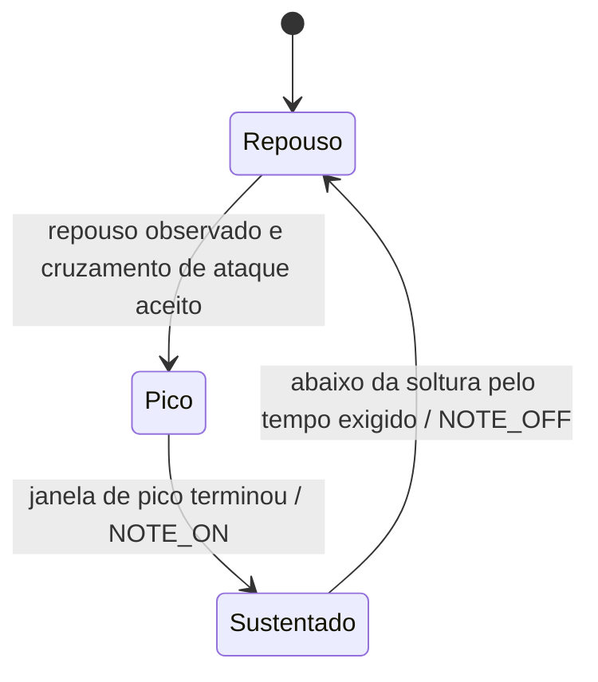

# Detector experimental dos pads

Implementação própria em `src/mk1_pad.c`. Não é tradução do processador musical NI nem calibração de fábrica. Recebe ADC bruto de um canal e emite eventos em memória; não envia MIDI, não acessa USB e não altera a página ou o equipamento.

## Máquina de estados



1. Após iniciar ou limpar o detector, é preciso observar uma amostra em repouso (`adc <= release`) antes de aceitar ataque. Isso evita uma nota só por conectar o sistema com o pad pressionado.
2. Um valor `>= attack` inicia a coleta de pico se o detector estiver armado e fora da janela de bloqueio após soltura. O cruzamento consome a armação mesmo se for bloqueado, para não produzir um ataque atrasado enquanto o sinal continua alto.
3. O maior valor até o fim da janela, incluindo sua fronteira, determina a velocity. A primeira amostra após a janela produz NOTE_ON. Uma amostra recebida além da fronteira não aumenta retroativamente o pico.
4. No estado sustentado não há novos NOTE_ON. Valores `<= release` precisam permanecer nessa região por `release_ticks`; uma leitura acima dela reinicia a contagem de soltura. `release` é estritamente menor que `attack`.
5. Um toque muito curto pode terminar ainda na janela de pico. Se o período de soltura já terminou, o mesmo lote entrega NOTE_ON seguido de NOTE_OFF, nessa ordem. O adaptador precisa consumir ambos.
6. `flush` solta uma nota já emitida ou descarta um ataque pendente. É explícito: o adaptador deve chamá-lo em desconexão/perda de fluxo. Sem amostras, o núcleo não executa sozinho.

## Parâmetros e saída

Não há valores padrão de sensibilidade no código. Cada instância recebe `mk1_pad_config`, com limiares, tempos e rota de saída. Deve haver um estado por canal/pad; o adaptador usa o mapa físico separadamente. Inicializar novamente um estado ativo requer antes consumir seu `flush` para não abandonar uma nota.

A curva inicial é linear, com saturação configurável:

```text
velocity = 127, se pico >= full_scale
velocity = 1 + floor((pico - attack) * 126 / (full_scale - attack)), caso contrário
```

Ela nunca usa velocity zero em NOTE_ON. Não é uma curva ajustada aos 16 pads. Pressão contínua, compensação de interferência, ajuste automático de sensibilidade e transporte MIDI continuam pendentes.

Todos os tempos usam o domínio de ticks escolhido pelo adaptador. Durações são menores que 2³¹ e amostras devem chegar em ordem modular, com intervalo menor que 2³¹. O código trata a passagem de 2³²−1 para zero e descarta bloqueios já expirados, para não reaplicá-los após uma volta completa do relógio. Tempos iguais são aceitos, mas não fazem as janelas avançarem. Retorno zero por entrada inválida preserva estado e lote de saída.

## Validação sem hardware

O teste C cobre ataque/pico, sustentação, oscilação na soltura, bloqueio de novo ataque, limpeza, wrap e entradas inválidas. O teste Python da biblioteca compilada cobre:

- Todas as 3.996 amplitudes de pico de 100 a 4095 com parâmetros sintéticos, verificando velocity monotônica e um par NOTE_ON/OFF por toque curto.
- Ruído abaixo de ataque, conexão com pressão inicial e 1.000 amostras de sustentação com quedas breves.
- Seis toques isolados, 16 instâncias com rotas independentes e limpeza sem NOTE_OFF duplicado.
- Entradas/configurações inválidas, ordem temporal, meia volta ambígua e longo repouso com volta completa do contador.

Esses testes especificam o algoritmo novo; não usam a FW55 como oráculo. Os testes anteriores de encoder/PWM permanecem separados.

## Replay de dados físicos existentes

`tools/replay_pad_detector.py` recebe uma captura local e a biblioteca host. Exige todos os parâmetros explicitamente. Usa o máximo das duas amostras do canal por relatório e converte os timestamps de chegada no host para microssegundos. Isso não mede a latência física do sensor ou do MIDI.

Ensaio local sobre a captura dos quatro cantos, sem acessar a MK1:

```powershell
python tools/replay_pad_detector.py <pasta-da-captura> --library build/core-host/mk1_core.dll --attack 120 --release 60 --full-scale 4095 --peak-us 10000 --release-us 10000 --retrigger-us 30000
```

Esses números são parâmetros de ensaio, **não configuração recomendada ou aplicada**. O resultado resumido está em `docs/PAD-DETECTOR-VALIDACAO.json`; dados brutos continuam locais. Esse replay não substitui ensaios de toques leves, rolls rápidos, pressão ou integração musical ao vivo.
