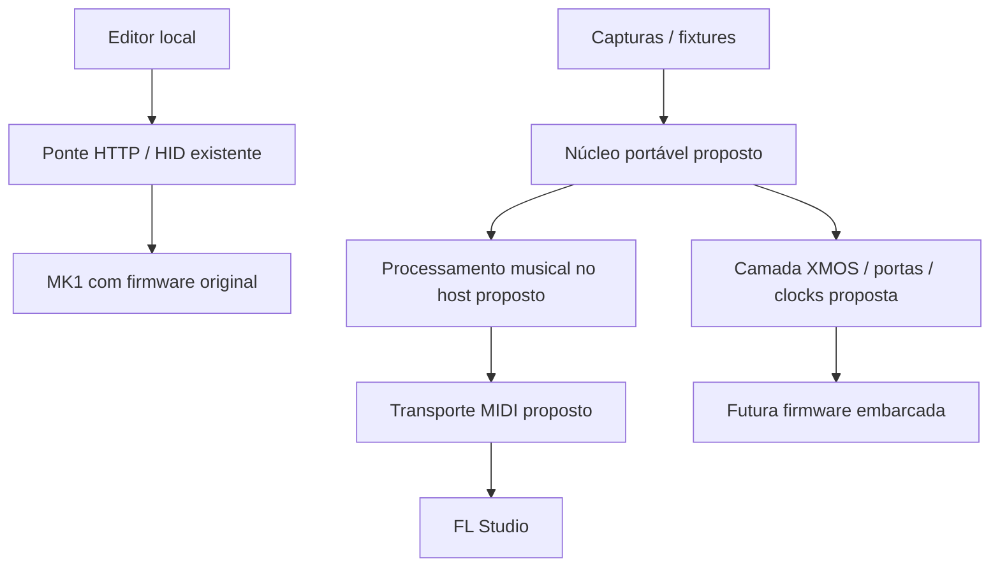

# Arquitetura proposta

Hoje o editor usa a ponte e a integração musical existente usa o serviço NI/driver MIDI e o script FL. Os blocos identificados como propostos ainda não estão implementados integralmente.

O núcleo deve receber amostras e emitir decisões, sem conhecer USB, HTTP, serviços Windows ou endereços físicos. A camada de saída converte decisões em quadros de LEDs, páginas de display e eventos musicais. A camada XMOS implementará os recursos temporizados, os canais entre tarefas/tiles e o USB, depois que seus contratos e inicialização forem sustentados por evidência.

Boot, atualização e recuperação são um subsistema independente. Não misturar funções de diagnóstico com comandos capazes de apagar/programar a flash. A porta XS1 local de um serviço não é um número de pino nem identifica por si só o tile físico.
