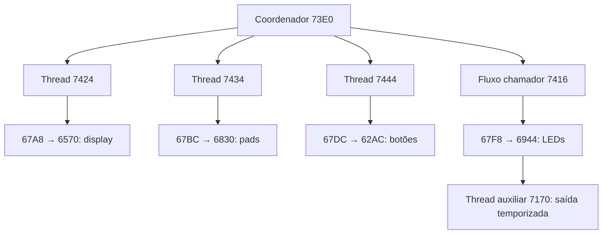

# Arquitetura da FW55 — segunda etapa de desmontagem

## Resultado novo

Foi reconstruído um caminho concreto de inicialização do segundo segmento: uma rotina cria três contextos de thread para botões, pads e display, e mantém o serviço de LEDs no fluxo chamador. As chamadas relativas foram resolvidas em offsets reais de arquivo e os acessos ao constant pool foram anotados com os valores encontrados na imagem.

Não há execução, emulação, conexão JTAG ou alteração da firmware nesta etapa. Os nomes de funções abaixo são rótulos de análise.

## Inicialização dos serviços de controle

| Caminho | Chamadas e evidência |
|---|---|
| Coordenador | 0x73E0 aloca grupo de threads; 0x73F8, 0x7404 e 0x7410 inicializam seus PCs; 0x7412 sincroniza |
| Display | thread em 0x7424 → wrapper 0x67A8 → serviço em 0x6570 |
| Pads | thread em 0x7434 → wrapper 0x67BC → aquisição em 0x6830 |
| Botões | thread em 0x7444 → wrapper 0x67DC → serviço em 0x62AC |
| LEDs | fluxo chamador: 0x7416 → wrapper 0x67F8 → serviço em 0x6944 |

Os wrappers 0x67A8–0x681C carregam argumentos de slots DP distintos. Isso separa os recursos fornecidos a cada serviço. Não significa que cada serviço corresponde a um chip separado. Também não é uma contagem de todas as threads da firmware: há outras inicializações nos dois segmentos.



## Pads: da ordem física ao seletor de aquisição

O constant pool do segmento 1 começa no offset 0x7BB8. A função em 0x6820 usa seus primeiros 16 words para traduzir índices de aquisição. A tabela é:

```text
índice:   0  1  2  3  4  5  6  7  8  9 10 11 12 13 14 15
seletor:  0  1  8  9  2  3 10 11  4  5 12 13  6  7 14 15
```

Essa tabela é uma permutação de 0..15. Em 0x689A a rotina de aquisição chama 0x6820 e em 0x689E escreve o seletor num recurso de saída. Depois espera 0x258 ticks, configura a leitura da porta, captura, aplica BITREV, mantém 12 bits, acrescenta o índice nos quatro bits superiores e grava a word.

Combinando a tabela com a calibração física:

| Pads físicos | Canais HID | Valores enviados ao seletor |
|---|---|---|
| 1, 2, 3, 4 | 12, 13, 14, 15 | 6, 7, 14, 15 |
| 5, 6, 7, 8 | 8, 9, 10, 11 | 4, 5, 12, 13 |
| 9, 10, 11, 12 | 4, 5, 6, 7 | 2, 3, 10, 11 |
| 13, 14, 15, 16 | 0, 1, 2, 3 | 0, 1, 8, 9 |

O padrão é compatível com seleção de canais de um circuito de aquisição multiplexado. Ainda não identifica o ADC, suas ligações elétricas ou os números dos pinos. Não convertemos os ticks em microssegundos sem confirmar o clock usado.

## Display e LEDs são serviços separados

O display chega à rotina 0x6570, que inicializa uma interface por comandos e escreve páginas. A interpretação de retângulo e o framebuffer continuam no multiplexador HID do segmento 0, em 0x04E8 e nos handlers E0. O teste físico já confirmou um retângulo no display. A ligação precisa dos identificadores de canal entre os segmentos ainda não foi provada.

O serviço de LEDs em 0x6944 inicia um array de 64 estados, possui evento de recepção em 0x704C e timer em 0x6A22. O handler de recepção extrai um índice do high-halfword em 0x7060 e um valor de 16 bits em 0x7078. O código trabalha com uma máscara de 5 bits em 0x707C e guarda o valor limitado em um estado indexado. Isso aproxima a etapa física da cópia de 60 bytes do report 0x80, mas o percurso completo da transformação entre esses formatos permanece em análise.

Importante: a máscara de 5 bits não deve ser confundida automaticamente com todos os campos de um report. Os 60 bytes são copiados pelo handler HID antes da transferência por canal. A calibração mostrou 52 endereços com resposta visível e oito sem iluminação identificada; não concluímos defeito nesses oito.

## Saída auxiliar temporizada

Em 0x6944 há criação de outro contexto que entra em 0x7170. Esse código recebe um valor pelo canal, incrementa uma fase módulo 101 e escreve nível lógico em uma única porta conforme a comparação de fase com o valor recebido. Reconhece também os extremos 0 e 100, e agenda eventos com incremento 0x1EF.

Pseudocódigo estrutural:

```text
ao receber pelo canal: duty = valor
ao ocorrer timer:
    phase = (phase + 1) % 101
    output = 1 se duty == 100
             0 se duty == 0
             phase < duty nos outros casos
    next_deadline += 0x1EF
```

Atualização de 05/11/2026: o caminho foi ligado ao campo 7 do Feature Report F8 e validado fisicamente como controle do backlight do display. Consulte F8-DISPLAY.md para os offsets, leitura de retorno, restauração e ressalva de polaridade. Essa rotina não é o PWM de toda a matriz de LEDs.

## Recursos e memória

Bases relativas ao arquivo recuperadas do startup:

| Segmento | Constant pool (CP) | Data pointer (DP) |
|---|---|---|
| 0 | 0x51D0 | 0x53D8 |
| 1 | 0x7BB8 | 0x7D0C |

São posições correspondentes no arquivo, **não endereços absolutos de RAM**. A anotação resolve um acesso CP[i] para um offset de arquivo e o word presente nele. Os acessos DP podem apontar para áreas inicializadas ou para estado alterado em runtime; não se deve tratar o conteúdo inicial como valor permanente.

Exemplos de words iniciais nos slots usados pelos wrappers do segmento 1:

| Serviço | Slots DP | Valores iniciais |
|---|---|---|
| Display | 0x10, 0x0F, 0x11 | 0x00080200, 0x00080000, 0x00010200 |
| Pads | 0x16, 0x13, 0x14, 0x12, 0x15 | 0x00080100, 0x00010800, 0x00010A00, 0x00010700, 0x00000306 |
| Botões | 0x0E, 0x0D, 0x0B, 0x0C | 0x00000206, 0x00010B00, 0x00010C00, 0x00010900 |
| LEDs | 0x0A, 0x07, 0x06, 0x08, 0x09, 0x17 | 0x00000106, 0x00010600, 0x00010100, 0x00010400, 0x00010300, 0x00010D00 |

Esses valores são candidatos a identificadores de recursos xCORE, conforme seus usos em instruções de porta/clock. Não são números de pinos do encapsulamento. Não lhes atribuímos nomes de sinais elétricos sem confirmar o modelo e a tabela de recursos aplicável.

## Índice de controle de fluxo

`trace_fw55.py` gera:

- `segment0.annotated.asm` e `segment1.annotated.asm`: destinos de saltos/chamadas e valores do constant pool.
- `control-flow.json`: chamadas diretas, handlers de eventos e candidatos a entrada de thread.

Foram indexadas 356 instruções de chamada direta no primeiro recorte e 62 no segundo. São **sites de chamada**, não número de funções ou de tarefas. Há candidatos a prólogos por ENTSP; chamadas indiretas, tail calls, trechos de dados e funções sem prólogo exigem revisão.

Verificações automatizadas: hash da imagem normalizada, destino do branch de seleção do LED (0x07E2 → 0x08B4), base CP do segundo segmento e permutação completa dos 16 seletores. A resolução usa o PC após a instrução e deslocamento em unidades de 16 bits, compatível com os destinos de código observados.

## O que falta para um mapa elétrico

1. Relacionar os recursos dos wrappers ao processador exato e aos sinais da placa.
2. Rastrear a criação/roteamento dos canais entre os dois segmentos.
3. Separar filtragem e processamento de pads da aquisição bruta — não presumir que a curva MIDI esteja na firmware.
4. Validar checksums e cabeçalho/carregamento antes de inferir compatibilidade de imagens modificadas.

Não houve preparação de uma firmware modificada nem teste de gravação.

Referência primária de instruções: https://www.xmos.com/download/The-XMOS-XS1-Architecture%281.0%29.pdf — BLRF/BLRB, LDAPF/LDAPB, INIT, SETV e operações de recursos.
