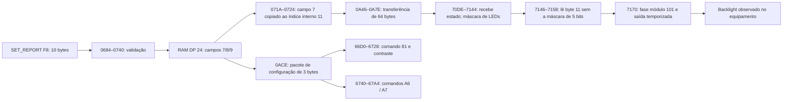

# Feature Report F8: caminho de configuração do display

## Descoberta confirmada em 05/11/2026

O campo 7 do payload do report F8 controla a iluminação de fundo do display. O usuário observou a tela escurecer durante o teste. O caminho estático foi seguido até a rotina PWM do segundo segmento, anteriormente classificada como saída auxiliar desconhecida.

Isso permite renomear a rotina 0x7170 como **PWM da luz de fundo do display**, mantendo a ressalva de que não houve observação de pino por osciloscópio/JTAG.

## Offset e estrutura

O report lido tem 11 bytes: ID F8 + 10 bytes de payload. Os offsets abaixo são relativos ao payload, sem o ID.

| Campo | Offset no pacote incluindo ID | Significado / evidência |
|---|---|---|
| Payload 0..6 | 1..7 | Preservados; sem nova interpretação nesta etapa |
| Payload 7 | 8 | Controle de backlight, limitado pela firmware a 0..100; efeito físico confirmado |
| Payload 8 | 9 | Contraste confirmado fisicamente: limitado a 0..100, convertido em floor(31*v/100) e enviado após comando LCD 0x81 |
| Payload 9 | 10 | Inversão de pixels confirmada fisicamente: seleciona comando LCD 0xA6 ou 0xA7 conforme zero/não zero |

Os campos 8 e 9 foram posteriormente testados fisicamente, conforme os registros abaixo. Os primeiros sete bytes não devem ser sobrescritos com valores inventados.

## Ligação estática reconstruída



O report de LED 80 continua copiando seus 60 bytes para índices internos 0..7 e 12..63. Assim, não alcança o índice 11, reservado por este caminho para backlight. Isso explica por que acender os LEDs e controlar a iluminação do LCD são operações distintas.

O receptor de LEDs aplica máscara 0x1F aos estados da matriz, mas depois obtém o byte original 11 do buffer recebido e o envia à thread PWM. Não se deve limitar o backlight a 31 por confundi-lo com o domínio dos LEDs.

## Teste físico e polaridade

Registro completo: `f8-field7-physical-test.json`.

```text
Antes:    F8 80 00 40 00 01 00 01 00 2A 00
Durante:  F8 80 00 40 00 01 00 01 0F 2A 00
Depois:   F8 80 00 40 00 01 00 01 00 2A 00
```

O valor original nesta sessão era **0**, não 63 (que havia aparecido em uma leitura anterior). O teste alterou somente o byte de pacote 8 para 15 por 20 segundos. A leitura de retorno coincidiu integralmente com o report solicitado. O usuário confirmou que o display ficou mais fraco. O original foi restaurado e relido com igualdade byte a byte.

Portanto, a hipótese inicial de que o teste reduziria numericamente o valor original estava incorreta: nesta sessão houve aumento 0→15. O efeito é consistente com uma saída de polaridade ativa baixa, mas ainda não validamos os extremos ou uma curva de brilho. O domínio 0..100 não deve ser apresentado como percentual crescente de brilho sem calibrar o sentido.

Nenhum comando DFU, flash download, apagamento ou gravação de firmware foi enviado. O teste escreveu uma configuração de runtime pelo Feature Report e a restaurou. NIHardwareService foi restaurado em execução ao final.

## Resultado para a arquitetura

Agora há um caminho associado ao comportamento físico para a thread PWM: backlight. Contraste e inversão também foram confirmados por testes visuais separados e leitura de retorno; a direção de toda a escala do backlight permanece sem calibração completa. A identificação do controlador LCD e dos pinos permanece aberta.

## Confirmações adicionais em 05/11/2026

### Contraste

Pacote original `F8 80 00 40 00 01 00 01 00 2A 00`. Somente o byte de pacote 9 foi alterado de 42 para 70 (`46` hexadecimal), por 20 segundos. O usuário confirmou que o padrão ficou mais escuro. A firmware converte esses valores para 13 e 21 no comando LCD 0x81, conforme a escala inteira floor(31*v/100). A leitura durante o teste coincidiu com o pedido.

Registro: `f8-contrast-physical-test.json`. O original foi restaurado exatamente, e NIHardwareService voltou a Running. A observação confirma a direção 42→70 nesta sessão, sem caracterizar uma curva óptica completa.

### Inversão

Somente o byte de pacote 10 foi alternado de 0 para 1, por 20 segundos. O usuário confirmou o negativo da imagem (pixels claros/escuros trocados). Os demais campos foram preservados. A leitura durante o teste coincidiu com o pedido.

Registro: `f8-inversion-physical-test.json`. O original foi restaurado exatamente, e NIHardwareService voltou a Running. O padrão de teste de 16×16 foi limpo após cada execução. Nenhuma firmware foi alterada.
